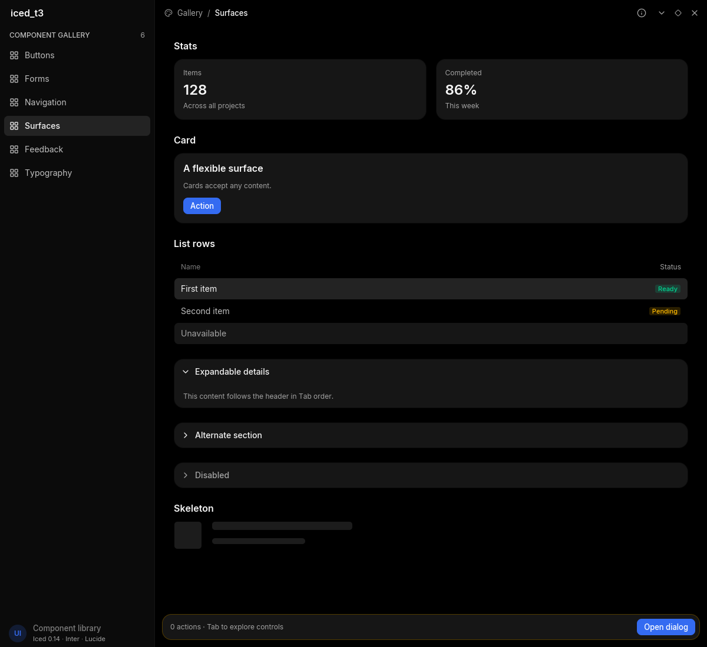

# iced_t3

[T3 Code](https://github.com/pingdotgg/t3code)'s dark design language for
[Iced](https://iced.rs) 0.14: theme, Inter and Lucide fonts, styled widgets and
client-side window decorations, generic over your `Message`. This is an independent
project, not affiliated with T3 Code.



```sh
cargo run --example gallery   # on NixOS: nix-shell --run '...'
```

## Getting started

```toml
[dependencies]
iced = "=0.14.0"
iced_t3 = { git = "https://github.com/synsejse/iced_t3" }
```

```rust,no_run
use iced::widget::column;
use iced::{Element, Task};
use iced_t3::{chrome, widget as t3};

#[derive(Debug, Clone)]
enum Message {
    Window(chrome::Action),
    Save,
}

fn update(_: &mut (), message: Message) -> Task<Message> {
    match message {
        Message::Window(action) => chrome::perform(action),
        Message::Save => Task::none(),
    }
}

fn view(_: &()) -> Element<'_, Message> {
    let page = column![
        chrome::titlebar("My app", None, Message::Window),
        t3::primary("Save", Some(Message::Save)),
    ];
    chrome::frame(page, Message::Window)
}

fn main() -> iced::Result {
    iced::application(|| (), update, view)
        .theme(|_: &()| iced_t3::theme())
        .settings(iced_t3::settings_for("my-app"))
        .window(chrome::window_settings_for("my-app"))
        .run()
}
```

`iced_t3::settings()` returns plain `iced::Settings`, and
`chrome::window_settings()` plain `window::Settings`. Change their fields with
struct update syntax, for example to set a window size.

## What's included

| Module | Contents |
|---|---|
| `color` | Design tokens: surfaces, text levels, tones and hairlines |
| `font` | `REGULAR`, `MEDIUM`, `SEMIBOLD`, `ICONS` |
| `icon` | Every Lucide icon as a `char` constant |
| `style` | Style functions for Iced's own widgets, such as `style::slider`, `style::input` and `style::pick_list` |
| `widget` | Buttons, `switch`, `segmented`, `setting`, `section`, `composer`, `breadcrumb`, `alert`, `badge`, `tooltip`, `empty_state`, `modal`, `dialog`, `scroll`, `icon_button`, `icon_toggle`, `icon_choice`, `swatch`, `dots`, `spinner`, `check` and more |
| `widget` forms | `checkbox`, `input`, `search`, plus `switch` and `segmented` |
| `widget` navigation | `tab`, `tabs`, selectable `chip`, `list_row`, `accordion` |
| `widget` surfaces | `card`, `stat`, `progress`, `shortcut`, `avatar`, static `skeleton` |
| `widget` sidebar | `sidebar`, `sidebar_nav`, `sidebar_group` with `sidebar_choice` and `radio`, `sidebar_device`, and T3 Code's thread rows `sidebar_row` and `sidebar_item` |
| `chrome` | `frame`, `titlebar`, `bar`, `controls`, `drag_region`, `perform` |
| `focusable` | Adds Tab and Enter/Space to any widget that takes a press |
| `cancellable` | Lets Escape abandon a drag, for example on a slider |

Interactive widgets take `Option<Message>`. `None` draws them disabled and takes
them out of Tab order. Keyboard focus shows a ring; a mouse click does not.

Pad a page with `widget::PAGE_GUTTER` when a `composer` sits below it. The composer
overhangs the page by more than its corner radius, so content scrolling behind it
ends on its straight edge.

`dots()` and `spinner()` animate themselves, so an app only has to show them.
`primary_busy` and `primary_small_busy` put dots in a button without changing its
width.

Use `widget::text(content, size)` instead of Iced's `text`. Iced's default line
height is fractional and it truncates fractional positions, which leaves neighbours
a pixel or more out of line. `text` uses a whole, even line height, so with even
paddings and icon sizes everything centers exactly. For a widget with its own text,
pass `widget::line_height(size)` to it.

To use a widget this crate doesn't wrap, apply a function from `style`:

```rust,ignore
slider(0.0..=100.0, value, Message::Level).style(style::slider(true))
```

## Window decorations

`chrome::frame` adds invisible resize edges around the whole window, and
`chrome::titlebar` or `chrome::bar` add a titlebar with window controls. Wrap
other surfaces, such as a sidebar header, in `chrome::drag_region` to make them
drag the window too. Dragging starts only once the pointer moves a few pixels,
so a click or double-click on a titlebar stays a click. Double-clicking toggles
maximize.

Use `settings_for(id)` and `chrome::window_settings_for(id)` with the basename of
your desktop entry to set the application and Wayland identities.

## Gallery and migration

The gallery has six pages: Buttons, Forms, Navigation, Surfaces, Feedback and
Typography. Controls share live state; notices dismiss, accordions expand, and
the footer opens a modal. Each page scrolls independently of its navigation. Start on a specific page with
`cargo run --example gallery -- surfaces`.

See [MIGRATION.md](MIGRATION.md) for every breaking change and its replacement.

Render all pages with the software renderer, including narrow windows:

```sh
GALLERY_CAPTURE_DIR=target/gallery cargo test --example gallery
```

`TileSize::{Compact, Standard, Large}` gives icon tiles even 32, 36 and 48px
bounds. New components use the same fonts, surfaces, borders and semantic tones
as the original widgets. Skeletons are static; loaders still animate themselves.

## Limitations

The theme is dark only. Windows have square corners, and the resize edges stay
active while maximized, where compositors ignore them.

## License

MIT. Inter is under the SIL Open Font License and Lucide under the ISC License;
see `assets/fonts`. The colors and proportions follow T3 Code, which is under the
MIT License.
